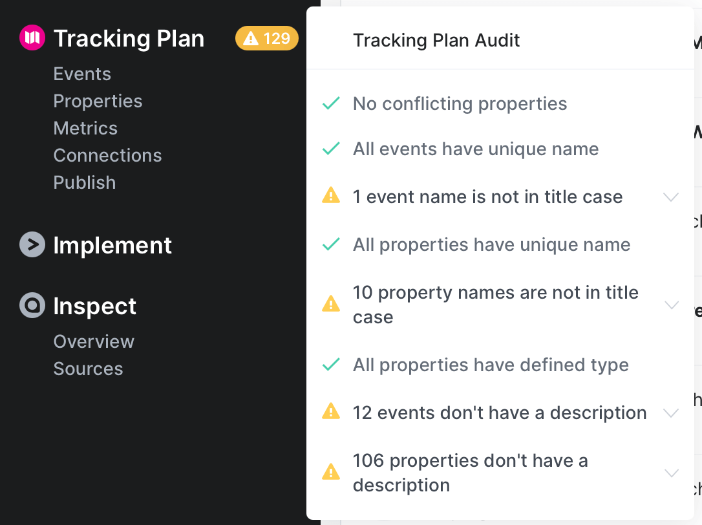
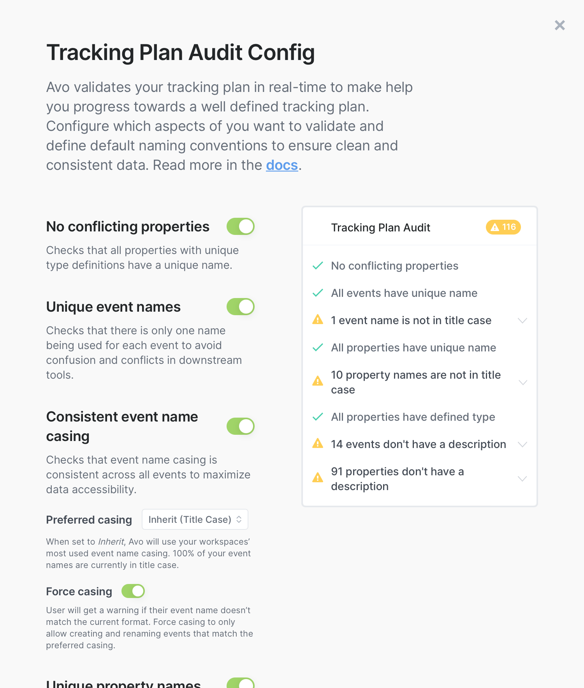

import { Callout } from 'nextra/components'

# Avo tracking plan audit rules

_Learn how to read, fix and configure your tracking plan audit_

## Audit rules

Following are the rules Avo tests for in the tracking plan and branch audits. To learn more about how to get started with the tracking plan audit, see [Quickstart: Get your first audit](/audit/quickstart).

You will recognize the Tracking Plan Audit by the yellow exclamation point next to the Tracking Plan item in the sidebar. It’s meant to help teams follow their naming convention and surface issues like when a type is missing from a property.

Below is an overview of the reported issues and how you can resolve them.

## Event Rules

### All events have unique names

Checks if any two event names in the tracking plan conflict with each other. For event name to be unique, no other event can have the same name, independent from their case. Example of conflicting event names:

- "App Opened", "app opened", "app_opened", "app-opened"
- "Add to Cart", "Add to cart", "add_to_cart", "add-to-cart"
- "Checkout Started", "checkout started", "checkout-started"
- "Checkout Completed", "checkout completed", "checkout-completed"

#### How to resolve

Pick the casing that matches the one that is dominant one in your workspace and fix the implementation of those that don't fit your standards. Note that changing your existing tracking might cause issues in downstream tools and metrics. **Make sure to discuss with the consumers of the data before making such change**.

<Callout type="info" emoji="💡">**Best practice:** Have all event names unique to avoid confusion and conflicts in downstream tools, such as in data warehouses and dashboards.</Callout>

### Casing of event names is consistent

Checks if the casing of event names in the tracking plan is consistent. For event name to be consistent, it should be the same casing across all events. Example of inconsistent event names:

- "App Opened", "checkoutStarted", "checkout_completed"
- "Add to Cart", "addToCart", "add-to-cart"

<Callout type="info" emoji="💡">**Best practice:** Have all event names defined with consistent casing to increases the usability of the data. If the casing is not consistent the person using the data would not only need to know the event name they are looking for, but also the casing of the event name.</Callout>

#### How to resolve

Fix the names and implementation of the events that don't fit your standards. Note that this will only be fixed for the data going forward, not historical data. Note that changing your existing tracking might cause issues in downstream tools and metrics. **Make sure to discuss with the consumers of the data before making such change**.

<Callout type="info" emoji="💡">To enforce more granular event name rules in your workspace, including event name structure (such as “object action”) or hybrid casing conventions, you can set up [advanced event naming rules](/audit/advanced-event-naming-rules</Callout>

### All events have description

Checks if all events in the tracking plan have a description.

<Callout type="info" emoji="💡">**Best practice:** A well defined event description contains information such as when the event should be sent and why it's being tracked.</Callout>

### All events have owners

Checks if all events in the tracking plan have been assigned an owner from your [stakeholder teams](/data-design/avo-tracking-plan/stakeholder-domains). Event ownership helps establish clear responsibility for data structures and enables better governance workflows.

<Callout type="info" emoji="💡">**Best practice:** Assigning owners to events clarifies who is responsible for each data structure, enables automatic reviewer assignment during branch reviews, and ensures accountability for data quality and changes.</Callout>

#### How to resolve

**Assign stakeholder team ownership** to events that don't have owners from either event details or stakeholder team details. 
For detailed instructions on managing stakeholder ownership, see [Setting item ownership](/workspace-management/domains#setting-item-ownership).

#### Branch vs. Tracking Plan behavior

This audit rule behaves differently depending on the context:

- **Branch Audit**: Only validates *new events* added on the branch. Events that existed before the branch was created are not checked, allowing teams to incrementally improve ownership without blocking work on existing events.

- **Tracking Plan Audit**: Validates *all events* in the tracking plan, helping identify the complete scope of events that need owners assigned.

**Note**: When this rule is enforced at the branch level (available on the enterprise plan), branches cannot be merged until all new events have owners assigned.

[Learn more about stakeholder teams and ownership →](/data-design/avo-tracking-plan/stakeholder-domains)

### All events have at least one category

Checks for events that do not belong to any category when the rule is enabled. Categories make large tracking plans navigable, support filtering, and can be published to certain destinations. Requiring categories helps keep your plan organized and discoverable.

#### How to resolve

Add the event to one or more relevant categories. Learn more about [Categories](/data-design/guides/organizing-metrics-and-events#categories).

## Property Rules

### No conflicting properties

Checks if there are more than one definition of a property with the same name. This is the case where two properties have the same name, but different type definitions or descriptions. Example of conflicting properties:

- "User Id", type: string
- "User Id", type: int

#### How to resolve

Aligning the descriptions, types and property constraints of the conflicting properties and fix the implementation of those that don't fit your standards

### All property names are unique\*

Checks if any two property names in the tracking plan conflict with each other. For property name to be unique, no other property can have the same name, independent from their case. Example of conflicting property names:

- "User ID", "User Id", "user_id", "user-id"
- "email_adddress", "Email Address", "email_address", "Email-address"

#### How to resolve

Pick the casing that matches the one that is dominant one in your workspace and fix the implementation of those that don't fit your standards. Note that changing your existing tracking might cause issues in downstream tools and metrics. **Make sure to discuss with the consumers of the data before making such change**.

<Callout type="info" emoji="💡">**Best practice:** Have all property names unique to avoid confusion and conflicts in downstream tools, such as in data warehouses and dashboards.</Callout>

### Casing of property names is consistent

Checks if the casing of property names in the tracking plan is consistent. For property name to be consistent, it should be the same casing across all properties. Example of inconsistent property names:

- "User Id", "userId", "USER_ID"
- "Product Name", "product_name", "product-name"

#### How to resolve

Fix the names and implementation of the properties that don't fit your standards. Note that this will only be fixed for the data going forward, not historical data. Note that changing your existing tracking might cause issues in downstream tools and metrics. **Make sure to discuss with the consumers of the data before making such change**.

<Callout type="info" emoji="💡">**Best practice:** Have all property names defined with consistent casing to increases the usability of the data. If the casing is not consistent the person using the data would not only need to know the property name they are looking for, but also the casing of the property name.</Callout>

### All properties have defined types

Checks if all properties in the tracking plan have a defined type. Every property should at least have their base type defined, one of: string, int, float, boolean or [object](/data-design/object-properties). In Avo you can in addition to the base types define a list of possible values for string properties, and min and max values for numeric properties.

#### How to resolve

Assign the intended type for the property and make sure that the tracking implementation matches the assigned type.

<Callout type="info" emoji="💡">**Best practice:** Have well defined types for all properties to increase the quality of the tracking implementation. Having well define types is the prerequisite for having your tracking consistent across all products and platforms.</Callout>

### All properties have description

Checks if all properties in the tracking plan have a description.

#### How to resolve

Add descriptions to all properties to increase the quality of your tracking plan.

<Callout type="info" emoji="💡">**Best practice:** A well defined property description contains detailed description of what the property is describing, and how it's value should be fetched.</Callout>

### All properties have at least one category

Checks for properties that do not belong to any category when the rule is enabled. You can filter by categories in the properties view and they make the tracking plan more navigable.

#### How to resolve

Add the property to one or more relevant categories. Learn more about [Categories](/data-design/guides/organizing-metrics-and-events#categories).

\* These rules can only fail after importing an existing tracking plan to Avo. When editing your Tracking Plan in Avo, Avo prevents you from introducing conflicting events and properties.

## Custom Field and PII Rules

These rules enforce the [custom field](/data-design/avo-tracking-plan/governance/custom-fields) and [PII](/data-design/avo-tracking-plan/governance/tagging-pii) standards defined on the [Governance](/data-design/avo-tracking-plan/governance) page and are available on the Enterprise plan.

### All events and variants have required custom fields

Checks if all events and event variants have a value for every custom field that applies to events and is marked as required. Event variants inherit custom field values from their base event, so filling in the base event also resolves its variants.

#### How to resolve

Fill in the missing custom field values in the Custom Fields section of the event details, on a branch.

### All properties have required custom fields

Checks if all properties have a value for every custom field that applies to properties and is marked as required.

#### How to resolve

Fill in the missing custom field values in the Custom Fields section of the property details, on a branch.

### All properties have PII declared

Checks for properties with an Undeclared [PII status](/data-design/avo-tracking-plan/governance/tagging-pii). Every property defaults to Undeclared until someone explicitly reviews it and marks it as either Not PII or PII, so this rule ensures every property in your tracking plan has been reviewed for personally identifiable information. Enforced in the [branch audit](/audit/branch-audit), it guarantees every new property gets a PII declaration before it goes live.

#### How to resolve

Open the property details, click the PII pill in the header and mark the property as Not PII, or as PII with the relevant PII type selected.

<Callout type="info" emoji="💡">**Best practice:** Declaring a PII status on every property makes it visible at a glance which events touch sensitive data and gives downstream consumers a reliable signal in [exports](/publishing/exporting).</Callout>

## Gateway Rules

These rules check the transformation rules of your [gateways](/data-design/avo-tracking-plan/gateways): what each input, the gateway itself and each output change about the events that pass through. They show in the branch audit for workspaces that use gateways. Each issue names the gateway and the input, gateway or output it's about, says what is wrong and gives the fix. Click it to open the gateway's transformations.

All five are warnings by default. Like every other audit rule, a rule blocks only once you set it to enforced.

### Required property not met

Checks that a property an output requires (a Require rule) arrives on every event the rule covers. It reports an event that doesn't have the property, never sends it, sends it only sometimes, or has it dropped by an input on the way.

#### How to resolve

Add the property to the event, send it on every event the rule covers, remove the upstream rule that drops it, or leave those events out of the rule.

### Gateway sends data that doesn't match the tracking plan

Checks that what leaves each input, gateway and output matches the tracking plan: two events or two properties renamed to the same name, a pinned value that doesn't fit the type an input changes the property to, no allowed value left to send, and object keys that clash.

#### How to resolve

Rename one of the clashing events or properties, or drop one of them, or change the pin or type so they fit. When no allowed value gets through, allow at least one of the values that arrive, or loosen the restriction.

### Drop transformation can never apply

Checks that the condition of each drop transformation can be met where it sits. It reports a drop transformation whose condition property isn't on the events it covers, is dropped before it gets there, or is archived. Drops with a "not one of" or "is not set" condition apply when the property is missing, so they're never reported.

#### How to resolve

Put the condition on a property that arrives at that input or output, or move the transformation to where the property arrives.

### Gateway transformation has no effect

Checks for transformations that change nothing: a rule a removal always undoes or a later rule always overrides, a Tighten rule with nothing set, a rule on an archived property, a rename of an event no output lets through, a disallowed value the property no longer allows, an output that lets no events through or isn't connected to a destination, and a key rule on a key the object no longer has.

#### How to resolve

Remove the rule, or change what undoes or overrides it. If the rule points at something that's gone, restore it or point the rule elsewhere: unarchive the property, let the event through to an output, allow the value again, or add the key back to the object. Connect an output that sends nothing to a destination, or let at least one event through.

### Inconsistent transformations across gateway inputs

Checks that a gateway's inputs treat the same event and property the same way: its name, type and allowed values. It also reports a property bundle member that a rule changes on some of the events carrying the bundle and not on others. It reports the gateway, and each output the difference reaches.

#### How to resolve

Apply the same rule on every input, or on none, or move it to the gateway itself.

## Audit Rule Configuration

For new workspaces all rules are enabled by default, and casing rules default to the most common casing seen in the workspace. Workspaces on the Team and Enterprise plans are able to configure the audit to include or exclude each rule and manually set their casing rules for events and properties. 

Additionally, workspaces on the Enterprise plan are able to define [advanced event naming rules](/audit/advanced-event-naming-rules) that include event name structure (such as “object action”) and hybrid casing conventions.

To configure your audit – click the yellow exclamation point next to the Tracking Plan item in the sidebar and then click “configure”

### Enforcement
Workspaces on the Enterprise plan are able to enforce each audit rule to ensure no new issues are introduced to your tracking plan.
Depending on your team’s preferred workflow, you can set the enforcement to two different stages of the branch lifecycle:
- **Request for review**: Requires the branch to pass all enforced audit rules before being reviewed
- **Branch merge**: Requires the branch to pass all enforced audit rules before it is merged to the main branch.

 <Callout type="info" emoji="💡"> Marking the branch status as `Request for review` will also block the branch from being merged if any changes where made after approval  </Callout>

